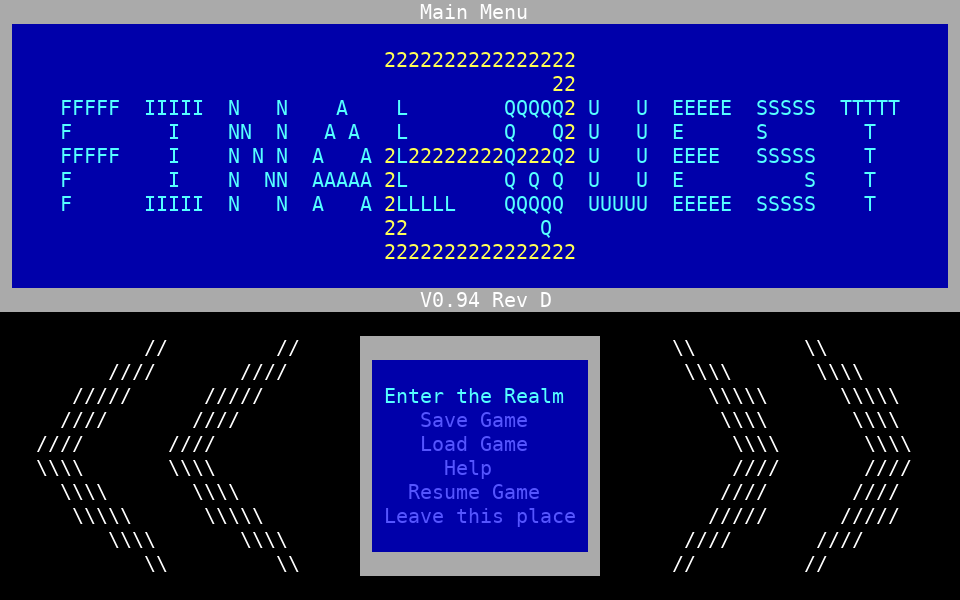
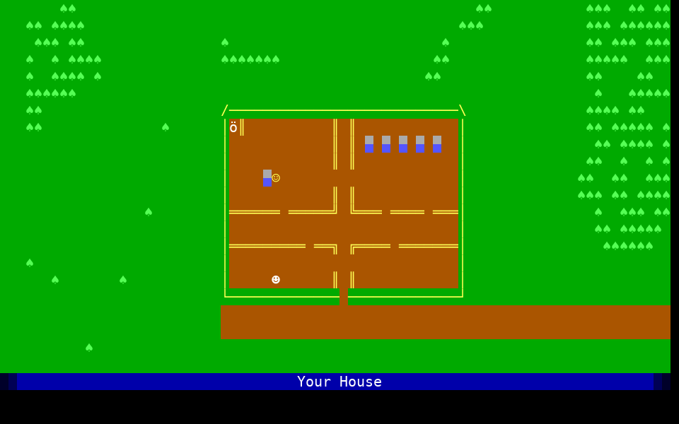

# Final Quest 2 - TypeScript Rewrite

Final Quest 2 is a text-mode RPG writen QBASIC in late 90s, early 00s, inspired by Legend of the Red Dragon (both 1 and 2) by Seth Robinson. This is a TypeScript rewrite of it that runs in a terminal with [Bun](https://bun.sh/).

The original QBASIC source, level editor, map renderer, map generator and REF scripting docs are in the original repo: [bafetk/final-quest-2](https://github.com/bafetk/final-quest-2).

The original game running in DOSBox:





## Running

You need [Bun](https://bun.sh/) and a terminal of at least 80x25:

```sh
bun install            # dev tools only (TypeScript, ESLint); not needed just to play
bun start              # or: bun games/fq2/fq2.ts
bun run debug          # or: bun games/fq2/fq2.ts --debug   (position display, S = settings editor)
```

Saved games go to `saves/` as JSON. Set `FQ2_COLORS=16` if your terminal lacks true-color support.

While exploring: arrows (or 8 4 6 2) walk, **I** or **V** shows your stats and inventory (pick an item to use, equip or drop it), **M** the world map, **B** the last messages, **R** redraws the screen, **?** lists the keys and **Esc** goes back to the title menu.

Text and maps are Unicode (UTF-8): a map cell can hold any character one column wide (letters with accents, Greek, Cyrillic, box drawing, blocks, symbols...), but not wide ones like emoji or CJK, which would put the screen out of line. Anything that doesn't fit a cell is shown as `?`.

Items are defined in `games/fq2/data/items.json` and monsters and encounter tables in `games/fq2/data/monsters.json`.

## Multiplayer server

```sh
bun run server                     # telnet on 2323, SSH on 2222, web on http://127.0.0.1:8080/
bun run server --host 0.0.0.0      # let other computers connect (-h for all the options)
```

Players connect with a telnet client (`telnet localhost 2323`), SSH (`ssh -p 2222 localhost`, with any user name and no password) or a web browser, make an account, and play. Every account has an email address, confirmed with a code sent to it, and one address can only have one account. A forgotten password is reset from the login menu with another code, and the address can be changed from the menu in the game (Escape), which takes the password and a code sent to the new address. The codes are sent through an SMTP server:

```sh
FQ2_SMTP_PASSWORD=... bun run server --smtp-host smtp.example.com --smtp-user game@example.com
```

Without `--smtp-host`, emails are written to the server's log instead, for trying it out.

Every option can also be set as an environment variable (`--smtp-host` is `FQ2_SMTP_HOST`, and so on), or kept in a `.env` file in the folder the server is started from: copy [.env.example](.env.example) to `.env` and fill it in. Options on the command line win. `.env` is ignored by git, so the SMTP password stays out of the repository.

Players' games are saved in `server-data/fq2.sqlite` as they go (passwords are stored as argon2id hashes). The server listens only on this computer unless given `--host`. Telnet sends passwords unencrypted, so for play over the internet use SSH, or the web page behind HTTPS (`--no-telnet` turns telnet off). The server makes its SSH host key the first time, in `server-data/ssh_host_ed25519_key`; keep it, or players' SSH clients will warn that the server has changed.

(ssh2 is patched, in [patches/](patches/), not to load its optional native add-ons: Bun crashes loading them. It works without them.) Seeing and talking to other players comes next: see [docs/multiplayer.md](docs/multiplayer.md).

## Mods

Mods add screens, items, monsters and scripts to the game without changing it. Each is a folder in `mods/` with a `mod.ts` (TypeScript, using the same `g` API as the game's scripts) and any data files; the game and the server load them when they start (`--mods DIR` for another folder). [mods/_wishing-well/](mods/_wishing-well/) is an example (rename it without the `_` to switch it on), and [docs/mods.md](docs/mods.md) explains how to write one. Mods are code: only install ones you trust.

## Tools

New versions of the original's map tools, working on `games/fq2/data/maps/` directly:

```sh
bun run edit                       # the level editor (in the terminal; press ? for its keys)
bun run generate                   # fill every blank outdoor screen with generated terrain
bun run generate -s 8-10 --seed 7 -p preview.html -n   # try a seed without saving
bun run view                       # write world.html: the whole world, to open in a browser
bun run view -s 82,721-726         # only some screens (-o sets the output file, -h for help)
```

The editor opens on an overview of the whole 80x24 world grid, one cell per screen, coloured by kind. From there you can create, copy, delete and re-kind screens, and press Enter to edit one. Screens are painted with a brush (character, colours, and whether it's solid) using the keyboard or the mouse. Left-drag paints, right-drag selects, and a middle click picks up a cell as the brush. The bottom row is a palette: click the brush for the character picker, a colour to use it, or HARD/SOFT to switch. In the overview, click a screen to select it and click again to open it. There's a character picker (pages of box drawing, blocks, symbols, arrows, letters and more; or type any character, or give its code point with Tab), rectangle selections with fill, copy and stamp, undo/redo, and overlays for solid cells and trigger tiles. S saves to the map folder, and only screens that changed are rewritten.

The viewer lays the outdoor screens out where they sit on the world grid and lists the interiors after them, in their real characters and colours. It can zoom, and outline solid cells and trigger tiles.

The generator fills outdoor screens with land, water, forest, mountains and winding trails in the style of the hand-made screens. First create the screens in the editor (N makes a blank screen of a chosen kind); the generator fills blank screens, and only replaces finished ones with `--force`.
- Water follows the kinds: water screens become lakes and seas, and coasts form where they meet land, including hand-made land.
- Terrain comes from noise over the whole world, so neighbouring screens line up at their edges.
- Towns get a clearing in the middle, left for building by hand.
- Roads and open ground on a hand-made neighbour carry on across the edge, and any walkable patch that ends up cut off gets a path cleared to it.
- The same `--seed` always gives the same result, and `--preview` writes an HTML page of the new screens and their neighbours.

## Development

Bun runs the TypeScript directly but doesn't type-check it, so check before committing:

```sh
bun run check          # tsc (strict) + eslint (typescript-eslint strict-type-checked) + tests
bun test               # just the tests
bun run coverage       # tests with a coverage report
```

Code style follows the PER Coding Style (adapted from PHP): 4-space indents, single quotes, braces on every block, explicit `public`/`private`, no trailing whitespace. ESLint enforces it (`bunx eslint --fix .` fixes most of it). The code avoids `any`, `as` casts and `!` assertions. Lookups that can only miss because of a bug go through `at()`/`cellAt()` in [assert.ts](packages/engine/src/assert.ts), which throw. JSON files and saved games are checked when they're loaded ([validate.ts](packages/engine/src/validate.ts)), so a bad file fails with the path to the bad value, e.g. `monsters.json.monsters[1].hp: expected a whole number`.

## Layout

The repository is a Bun workspace: an engine and its multiplayer server and map tools as packages that other games could use, and Final Quest 2 as a game built on them.

- [packages/engine/](packages/engine/) (`@fq2js/engine`) is the game engine: terminal, screen, text markup, world, combat, items, saves, and the `g` API that scripts use ([script.ts](packages/engine/src/script.ts)). [testing.ts](packages/engine/src/testing.ts) is a kit for testing games: a `FakeTerminal` that plays back scripted key presses, so whole games can be driven from a test, and small maps, worlds and monsters.
- [packages/server/](packages/server/) (`@fq2js/server`) is the multiplayer server: telnet, SSH and web connections, accounts with email addresses, saves (SQLite, with [migrations](packages/server/src/migrations.ts)), and each player's session. [cli.ts](packages/server/src/cli.ts) is its command line, which a game runs with its content.
- [packages/tools/](packages/tools/) (`@fq2js/tools`) holds the map tools (see Tools above); a game gives them its map folder and trigger tiles.
- [games/fq2/](games/fq2/) is Final Quest 2:
  - [fq2.ts](games/fq2/fq2.ts) is the single-player entry point, [server.ts](games/fq2/server.ts) the multiplayer one, and [tools/](games/fq2/tools/) runs the map tools on its maps.
  - [content/](games/fq2/content/) is the game itself: every screen's triggers and all the scripts, written as async TypeScript functions (converted from the original REF files). [content/start.ts](games/fq2/content/start.ts) holds the starting player and the `Flags` type, so a misspelled flag is a compile error.
  - [data/](games/fq2/data/) holds the game data as JSON: `config.json` (from VARS.DAT), `items.json` (the item catalogue), `monsters.json` (monsters and encounter tables, from NOSCR.DAT) and one file per screen in `data/maps/` (from MAPS.DAT, now with screen names and terrain).
- Tests (`bun:test`) sit in each package's `test/` folder. The packages test themselves on Test Quest ([fixture.ts](packages/engine/src/fixture.ts)), a tiny game of four screens and a few triggers, with its data in [fixture/](packages/engine/src/fixture/), so they don't need Final Quest 2. FQ2's own tests are in [games/fq2/test/](games/fq2/test/): its scripts, data and maps, with its fixtures in [helpers.ts](games/fq2/test/helpers.ts). [content/data.test.ts](games/fq2/test/content/data.test.ts) runs every trigger in the game and checks that it sends the player somewhere real.
- [mods/](mods/) holds the mods to add to the game, and [docs/mods.md](docs/mods.md) is the guide to writing them ([mods.ts](packages/engine/src/mods.ts) is the loader).
- [docs/multiplayer.md](docs/multiplayer.md) is the plan for live multiplayer (telnet, SSH and web, LORD II style).
- [patches/](patches/) patches ssh2 not to load its native add-ons (Bun crashes loading them).

## License

See [LICENSE](LICENSE).
